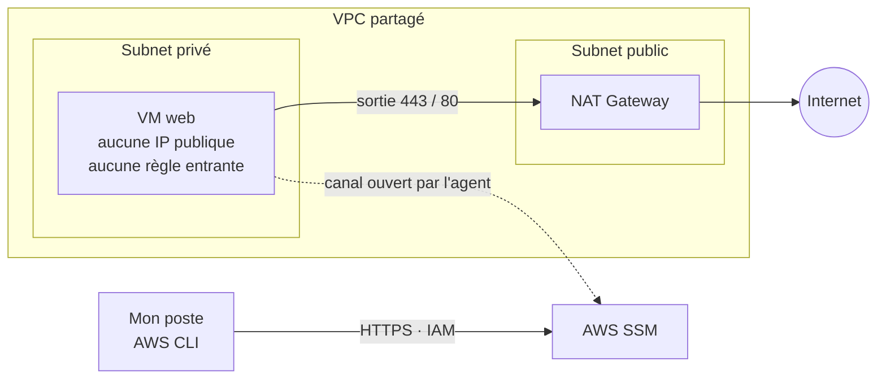

# Accès à une VM privée sur AWS

🇬🇧 [English version](README.md)

Comment administrer une machine virtuelle sur AWS qui **n'est joignable par aucun moyen depuis Internet** ? Ce dépôt documente toute la démarche : une VM web construite avec Terraform et Ansible, fermée à Internet, puis de nouveau administrable grâce à **AWS Systems Manager Session Manager**, sans IP publique ni port ouvert.

Rédigé pendant mon alternance en cybersécurité (Bachelor 3). Les documents 2 et 3 ont d'abord été publiés dans [aws-acces-vm-priv-](https://github.com/thomaspeyr31/aws-acces-vm-priv-).

## Résultat

| Vérification | Résultat |
|---|---|
| IP publique sur la VM | Aucune |
| Règles entrantes du security group | Aucune |
| Sortie (`apt`, agent SSM) | Par une NAT Gateway, ports 443 et 80 uniquement |
| Accès d'administration | Sessions SSM, authentifiées par IAM et journalisées dans CloudTrail |
| Site web | Visible sur `localhost` par redirection de port SSM, timeout depuis Internet |
| Recette | 7 tests sur 7 réussis |

## Contenu

| Document | Contenu |
|----------|---------|
| [1 · De Terraform à SSM](docs/01-terraform-ansible-private-vm.md) | Étude de cas en quatre temps : construire la VM en code, la configurer avec Ansible, la fermer, puis rétablir la sortie et l'accès avec un subnet privé, une NAT Gateway et SSM. Avec le processus de revue, deux incidents IAM et leur résolution, les 7 tests de recette, l'utilisation au quotidien et les coûts. |
| [2 · Comparatif des méthodes d'accès](docs/02-access-methods-comparison.md) | SSM Session Manager, EC2 Instance Connect Endpoint, bastion, Client VPN, VPN site à site, Direct Connect, WireGuard auto-géré : principe, prérequis, coût, sécurité et cas d'usage. |
| [3 · Guide de mise en place d'un EIC Endpoint](docs/03-eice-setup-guide.md) | Guide pas à pas en AWS CLI : VPC et subnet privés, VM sans IP publique, EIC Endpoint, politique IAM, et un mode « salle de classe » où plusieurs utilisateurs partagent un endpoint avec un accès par tag. |

## À retenir

- **Fermer une VM coupe aussi sa sortie** : sans IP publique, une VM d'un subnet public n'a plus de route vers Internet. La table de routage compte autant que le security group.
- **L'identité plutôt que le réseau** : avec SSM, l'accès dépend de qui tu es (IAM), pas d'une IP source ni d'un port ouvert.
- **`terraform plan` ne vérifie pas IAM** : simuler les droits avec `simulate-principal-policy` avant l'apply, et écrire dans la PR ce que le plan ne peut pas vérifier.
- **Moindre privilège, y compris pour soi** : demander des droits limités à un rôle, au tag du projet et à ses propres sessions.
- **Tout en code et relu** : aucun `terraform apply` avant la fusion de la pull request.

## Architecture finale

