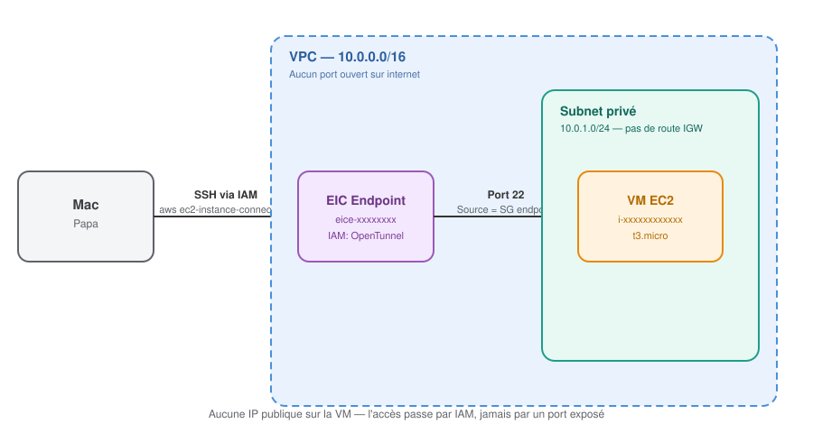

# Accès à une VM privée sur AWS

🇬🇧 [English version](README.md)

Comment administrer une machine virtuelle sur AWS qui **n'est joignable par aucun moyen depuis Internet** ? Ce dépôt documente toute la démarche, d'une VM web publique construite avec Terraform et Ansible jusqu'à une VM entièrement privée, et compare les façons d'y accéder une fois fermée.

Rédigé pendant mon alternance en cybersécurité (Bachelor 3). Les documents 2 et 3 ont d'abord été publiés dans [aws-acces-vm-priv-](https://github.com/thomaspeyr31/aws-acces-vm-priv-).

## Contenu

| Document | Contenu |
|----------|---------|
| [1 · De Terraform à Ansible, puis fermer l'accès](docs/01-terraform-ansible-private-vm.md) | Étude de cas : construire une VM web en code, la configurer avec Ansible, puis supprimer tout accès entrant depuis Internet. Avec le processus de revue (pull requests, corrections demandées) et les difficultés rencontrées. |
| [2 · Comparatif des méthodes d'accès](docs/02-access-methods-comparison.md) | SSM Session Manager, EC2 Instance Connect Endpoint, bastion, Client VPN, VPN site à site, Direct Connect, WireGuard auto-géré : principe, prérequis, coût, sécurité et cas d'usage. |
| [3 · Guide de mise en place d'un EIC Endpoint](docs/03-eice-setup-guide.md) | Guide pas à pas en AWS CLI : VPC et subnet privés, VM sans IP publique, EIC Endpoint, politique IAM, et un mode « salle de classe » où plusieurs utilisateurs partagent un endpoint avec un accès par tag. |

## À retenir

- **Aucun port entrant** : la VM n'a ni IP publique ni port ouvert sur Internet ; la sortie vers Internet peut exister.
- **L'identité plutôt que le réseau** : l'accès est accordé par IAM (qui tu es), pas par une règle d'IP source.
- **SSM Session Manager ou EIC Endpoint** couvrent la plupart des besoins d'administration pour un coût nul ou presque ; un VPN ne se justifie que pour un accès réseau à de nombreuses ressources.
- **Tout en code et relu** : aucun `apply` Terraform avant la fusion de la pull request.

## Architecture

