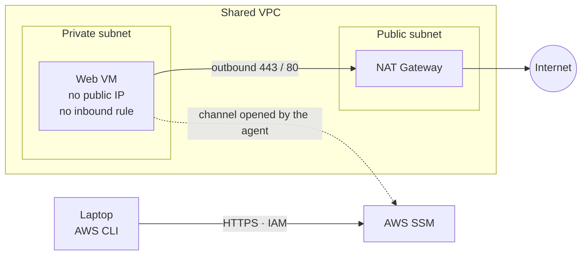

# AWS Private VM Access

🇫🇷 [Version française](README.fr.md)

How do you administer a virtual machine on AWS that **cannot be reached from the Internet at all**? This repository documents the whole journey: a web VM built with Terraform and Ansible, closed to the Internet, then made manageable again through **AWS Systems Manager Session Manager**, with no public IP and no open port.

Written during my work-study placement in cybersecurity (Bachelor year 3). The documents are in French. Documents 2 and 3 were first published in [aws-acces-vm-priv-](https://github.com/thomaspeyr31/aws-acces-vm-priv-).

## Result

| Check | Result |
|---|---|
| Public IP on the VM | None |
| Inbound security group rules | None |
| Outbound traffic (`apt`, SSM agent) | Through a NAT Gateway, ports 443 and 80 only |
| Admin access | SSM sessions, authenticated by IAM and logged in CloudTrail |
| Website | Visible on `localhost` through SSM port forwarding, timeout from the Internet |
| Acceptance tests | 7 / 7 passed |

## What's inside

| Document | Content |
|----------|---------|
| [1 · From Terraform to SSM](docs/01-terraform-ansible-private-vm.md) | Case study in four steps: build the VM as code, configure it with Ansible, close it, then restore outbound traffic and admin access with a private subnet, a NAT Gateway and SSM. Includes the review process, two IAM incidents and how they were solved, the 7 acceptance tests, daily usage and costs. |
| [2 · Comparing access methods](docs/02-access-methods-comparison.md) | SSM Session Manager, EC2 Instance Connect Endpoint, bastion host, Client VPN, Site-to-Site VPN, Direct Connect, self-managed WireGuard: how each works, prerequisites, cost, security, and when to use it. |
| [3 · EC2 Instance Connect Endpoint setup guide](docs/03-eice-setup-guide.md) | Step-by-step AWS CLI guide: private VPC and subnet, VM with no public IP, EIC Endpoint, IAM policy, and a "classroom" mode where several users share one endpoint with tag-based access. |

## Key takeaways

- **Closing a VM also cuts its outbound path**: without a public IP, a VM in a public subnet has no route to the Internet. Routing matters as much as the security group.
- **Identity instead of network**: with SSM, access depends on who you are (IAM), not on a source IP or an open port.
- **`terraform plan` does not check IAM**: simulate permissions with `simulate-principal-policy` before applying, and write in the PR what the plan cannot verify.
- **Least privilege, for yourself too**: request permissions limited to one role, one project tag and your own sessions.
- **Everything as code and reviewed**: no `terraform apply` before the pull request is merged.

## Final architecture

