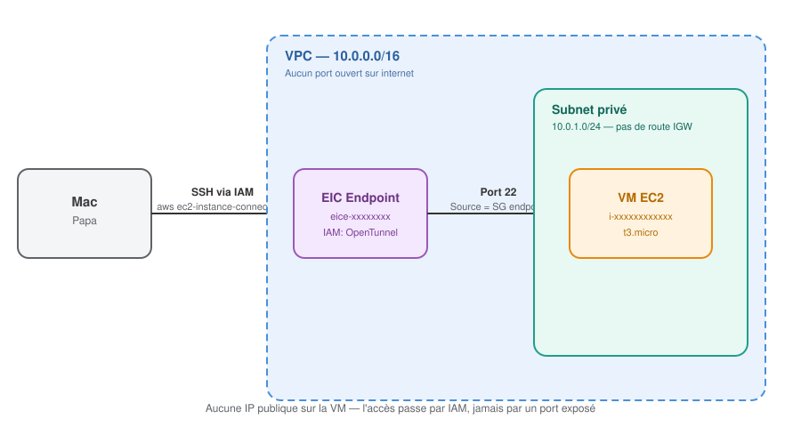

# AWS Private VM Access

🇫🇷 [Version française](README.fr.md)

How do you administer a virtual machine on AWS that **cannot be reached from the Internet at all**? This repository documents the whole journey, from a public web VM built with Terraform and Ansible to a fully private one, and compares the ways to reach it once it is closed.

Written during my work-study placement in cybersecurity (Bachelor year 3). The documents are in French.

## What's inside

| Document | Content |
|----------|---------|
| [1 · From Terraform to Ansible, then lock it down](docs/01-terraform-ansible-private-vm.md) | Case study: build a web VM as code, configure it with Ansible, then remove every inbound path from the Internet. Includes the review process (pull requests, fixes requested by the reviewer) and the problems met along the way. |
| [2 · Comparing access methods](docs/02-access-methods-comparison.md) | SSM Session Manager, EC2 Instance Connect Endpoint, bastion host, Client VPN, Site-to-Site VPN, Direct Connect, self-managed WireGuard: how each works, prerequisites, cost, security, and when to use it. |
| [3 · EC2 Instance Connect Endpoint setup guide](docs/03-eice-setup-guide.md) | Step-by-step AWS CLI guide: private VPC and subnet, VM with no public IP, EIC Endpoint, IAM policy, and a "classroom" mode where several users share one endpoint with tag-based access. |

## Key takeaways

- **Zero inbound ports**: the VM has no public IP and no port open to the Internet; outbound traffic can still exist.
- **Identity instead of network**: access is granted by IAM (who you are), not by a source IP rule.
- **SSM Session Manager or EIC Endpoint** cover most admin needs for free or almost; a VPN is only worth it when you need network-level access to many resources.
- **Everything as code and reviewed**: no Terraform `apply` before the pull request is merged.

## Architecture

