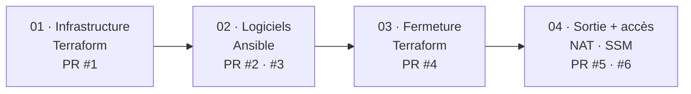
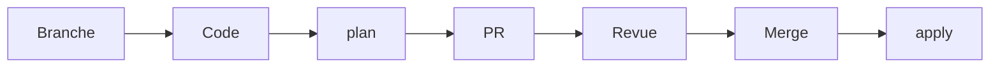
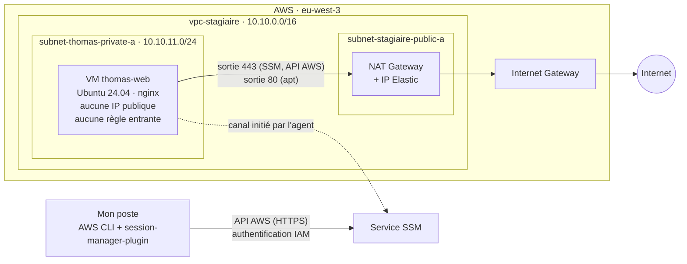

# Une VM web privée sur AWS, de Terraform à SSM

> Alternance Retengr · Bachelor 3 Cybersécurité · Thomas Peyrusaubes
> Dépôt de code associé : `nc-private-vm-access` (privé, Retengr)
> Dernière mise à jour : 19 novembre 2026

Cette étude de cas retrace la construction d'une VM web sur AWS en *Infrastructure as Code*, sa fermeture complète à Internet, puis la mise en place d'un accès d'administration qui n'ouvre **aucun port**. Elle raconte aussi les choix, les incidents rencontrés et la façon dont ils ont été résolus.

> 🔒 Les identifiants propres au compte (numéro de compte, ID d'instance, IP publiques) sont remplacés par des valeurs d'exemple.

## État du projet

| Étape | Outil | Statut |
|---|---|---|
| Temps 1 · Infrastructure | Terraform | ✅ Fusionné (PR #1) |
| Temps 2 · Logiciels | Ansible | ✅ Fusionné (PR #2, puis corrections PR #3) |
| Temps 3 · Fermeture | Terraform | ✅ Fusionné et appliqué (PR #4) |
| Temps 4 · Sortie + accès SSM | Terraform + IAM | ✅ Fusionné et appliqué (PR #5, correctif PR #6) |
| Recette | AWS CLI, Ansible | ✅ 7 tests sur 7 |

## Sommaire

1. [Le besoin](#1-le-besoin)
2. [Point de départ : une première version trop complexe](#2-point-de-départ--une-première-version-trop-complexe)
3. [La démarche en quatre temps](#3-la-démarche-en-quatre-temps)
4. [Temps 1 · L'infrastructure avec Terraform](#4-temps-1--linfrastructure-avec-terraform)
5. [Temps 2 · La configuration avec Ansible](#5-temps-2--la-configuration-avec-ansible)
6. [Méthode de travail](#6-méthode-de-travail)
7. [Temps 3 · Fermer l'accès direct](#7-temps-3--fermer-laccès-direct)
8. [Choisir comment entrer et comment sortir](#8-choisir-comment-entrer-et-comment-sortir)
9. [Temps 4 · Subnet privé, NAT et SSM](#9-temps-4--subnet-privé-nat-et-ssm)
10. [Les incidents IAM et leur résolution](#10-les-incidents-iam-et-leur-résolution)
11. [Recette : 7 tests](#11-recette--7-tests)
12. [Utilisation au quotidien](#12-utilisation-au-quotidien)
13. [Coûts et nettoyage](#13-coûts-et-nettoyage)
14. [Bilan](#14-bilan)
15. [Glossaire](#15-glossaire)

---

## 1. Le besoin

> « La VM ne doit jamais être joignable directement depuis Internet. La sortie vers Internet, elle, peut exister. »
> — Consigne du tuteur

| Élément | Choix |
|---|---|
| Région | `eu-west-3` (Paris) |
| Réseau | VPC partagé `vpc-stagiaire`, `10.10.0.0/16` |
| Serveur | Ubuntu 24.04, `t3.micro`, nginx |
| Accès final | VPN ou SSM, pas d'EICE |
| Méthode | Tout en code, tout relu en pull request |

---

## 2. Point de départ : une première version trop complexe

La première proposition (branche `ajout-vm-privee`) contenait : 2 subnets `/28`, une table de routage privée, un endpoint S3, un endpoint EICE, 3 security groups et une VM sans IP publique.

Elle était sécurisée, mais présentait trois limites :

| Limite | Explication |
|---|---|
| **CIDR écrits en dur** | Dans un VPC partagé, deux stagiaires qui créent le même subnet entrent en conflit. |
| **EICE** | Solution propriétaire AWS, refusée : l'accès doit passer par un VPN ou SSM. |
| **Un subnet de trop** | Le subnet dédié à l'EICE n'était pas nécessaire. |

**Leçon** : partir simple, valider, puis sécuriser étape par étape.

---

## 3. La démarche en quatre temps



| Temps | Objectif | Résultat |
|---|---|---|
| 01 · Infrastructure | Une VM qui démarre, accessible en SSH depuis mon IP | VM Ubuntu avec IP publique |
| 02 · Logiciels | nginx installé et une page personnalisée, sans toucher à l'infra | Playbook idempotent |
| 03 · Fermeture | Plus d'IP publique, plus aucune règle entrante | VM injoignable… et sans sortie |
| 04 · Sortie + accès | Rendre la sortie possible et administrer sans ouvrir de port | Subnet privé, NAT, SSM |

---

## 4. Temps 1 · L'infrastructure avec Terraform

### 4.1 Organisation du code

| Fichier | Rôle | Contenu clé |
|---|---|---|
| `versions.tf` | Outils et état | Terraform ≥ 1.10, provider AWS `~> 6.0`, backend S3, tag `rtg-project` |
| `variables.tf` | Réglages | `region`, `public_key_path`, `instance_type`, `private_subnet_cidr`, `ssm_instance_profile` |
| `main.tf` | Lire et créer | Data sources, key pair, security group, VM |
| `network.tf` | Réseau (temps 4) | Subnet privé, NAT Gateway, table de routage |
| `outputs.tf` | Affichage | `instance_id`, `vm_private_ip`, `nat_public_ip` |

> 🔒 `terraform.tfvars` et l'inventaire Ansible sont ignorés par git : aucune donnée personnelle n'est publiée.

### 4.2 Lire l'existant, ne créer que le sien

- `data` **lit** une ressource existante, sans rien créer.
- `resource` **crée** une ressource et la gère.

```hcl
data "aws_subnet" "public_a" {
  filter {
    name   = "tag:Name"
    values = ["subnet-stagiaire-public-a"]
  }
}
```

Le subnet est retrouvé **par son nom**, et l'image Ubuntu par son propriétaire (Canonical) : aucun ID d'AMI n'est écrit en dur. Chaque ressource créée est préfixée par le prénom (`thomas-web`, `thomas-web-sg`, `kp-thomas-web`…) pour éviter les collisions dans le compte partagé.

### 4.3 Sécurité dès le premier jour

- **IMDSv2 obligatoire** (`http_tokens = "required"`) : les métadonnées de la VM exigent un jeton, ce qui les rend bien plus difficiles à voler via une faille web de type SSRF.
- **Disque chiffré** : volume `gp3` chiffré, illisible hors du compte.
- **Ouverture minimale** : au temps 1, SSH et HTTP ne sont ouverts qu'à mon IP (`/32`), et l'IP publique est provisoire.

### 4.4 L'état Terraform, stocké dans S3

```hcl
backend "s3" {
  bucket       = "rtg-nc-tfstates"
  key          = "stagiaire/nc-private-vm-access/terraform.tfstate"
  region       = "eu-west-3"
  use_lockfile = true # verrou : deux apply ne peuvent pas se croiser
  encrypt      = true # état chiffré
}
```

Le provider ajoute automatiquement le tag `rtg-project = nc-private-vm-access` à toutes les ressources (`default_tags`). Le tuteur sait ainsi à quel projet appartient chaque ressource et ce qu'elle coûte. Ce tag servira aussi à limiter mes droits SSM à mes seules instances ([§10](#10-les-incidents-iam-et-leur-résolution)).

> ⚠️ **Leçon retenue** : ne jamais lancer `terraform init -reconfigure` sur un backend modifié. Terraform repartirait d'un état vide et « oublierait » les ressources déjà créées.

---

## 5. Temps 2 · La configuration avec Ansible

### 5.1 Le playbook `site.yml`

| Tâche | Module | Effet |
|---|---|---|
| 1 | `apt` | Installer nginx (`update_cache`, `cache_valid_time: 3600`) |
| 2 | `service` | Démarrer et activer nginx (`state: started`, `enabled: true`) |
| 3 | `copy` | Personnaliser la page : « Bonjour, je suis Thomas Peyrusaubes » |

Le passage d'Amazon Linux à Ubuntu 24.04 a demandé trois adaptations : l'utilisateur (`ec2-user` → `ubuntu`), le gestionnaire de paquets (`dnf` → `apt`) et le chemin de la page par défaut (`/var/www/html/index.nginx-debian.html`).

### 5.2 L'idempotence

| Exécution | Résultat | Signification |
|---|---|---|
| 1re | `changed=2` | nginx installé, page remplacée |
| 2e | `changed=0` | Tout est déjà en place, rien à refaire |

On peut relancer le playbook sans risque : il ne fait que ce qui manque. Les deux sorties sont jointes à chaque pull request comme preuve.

---

## 6. Méthode de travail



| Outil | Règle | Raison |
|---|---|---|
| **Terraform** | `apply` uniquement après revue et merge | Il crée des ressources payantes et modifie un compte partagé |
| **Ansible** | Test possible tout de suite, PR en parallèle | Il n'installe que des logiciels |

Chaque PR contient le `terraform plan` complet, les conséquences à valider et les questions ouvertes. Les messages de commit suivent le format `type(scope): description`, en anglais.

---

## 7. Temps 3 · Fermer l'accès direct

### 7.1 Ce qui change

| Élément | Avant | Après |
|---|---|---|
| SSH (22) | Ouvert à mon IP | **Fermé** |
| HTTP (80) | Ouvert à mon IP | **Fermé** |
| IP publique | Oui | **Aucune** |

AWS ne permet pas de retirer l'IP publique d'une VM existante : `associate_public_ip_address` force le remplacement. Le plan affiche donc `2 to add, 0 to change, 2 to destroy` (VM et security group recréés), et nginx disparaît avec l'ancienne VM.

### 7.2 Les preuves de fermeture

| Vérification | Commande | Résultat |
|---|---|---|
| IP publique | `aws ec2 describe-instances … PublicIpAddress` | `None` |
| Règles entrantes | `aws ec2 describe-security-groups … IpPermissions` | `[[]]` |
| Accès depuis Internet | `curl -m 5 http://<ancienne-ip>` | Timeout |

### 7.3 Le piège : plus de sortie non plus

Dans un **subnet public**, une VM ne sort vers Internet par l'Internet Gateway **que si elle a une IP publique**. En la retirant, on supprime aussi la sortie : plus d'`apt`, plus de mises à jour, et pas d'agent SSM possible, puisqu'il doit joindre AWS.

> Le security group décide **si** un trafic est autorisé ; la table de routage décide **par où** il passe. Une règle sortante ouverte ne sert à rien s'il n'existe aucune route.

Ce défaut était connu et écrit dans la PR #4. Il a été accepté pour séparer les étapes : d'abord fermer, ensuite rétablir proprement la sortie et l'accès.

---

## 8. Choisir comment entrer et comment sortir

Deux problèmes distincts se posaient, avec une contrainte découverte en lisant le VPC : `vpc-stagiaire` ne contenait que **3 subnets publics et aucune NAT Gateway**.

### 8.1 Entrer : les méthodes d'accès

| Méthode | Port exposé sur Internet | Port entrant sur la VM | Coût | Verdict |
|---|---|---|---|---|
| **SSM Session Manager** | Aucun | Aucun | Gratuit | ✅ Retenu |
| **VPN WireGuard** | 1 (UDP 51820) | 22/80 depuis le VPN | ~1 petite EC2 | Alternative portable hors AWS |
| **AWS Client VPN** | 1 (géré) | 22/80 depuis le VPN | ~75 $/mois | Trop cher pour une VM |
| **EICE** | Aucun | 22 depuis l'endpoint | Gratuit | ❌ Exclu par le tuteur |
| **Bastion** | 1 (TCP 22) | 22 depuis le bastion | ~1 petite EC2 | ❌ Le plus exposé |

Le détail de chaque méthode est dans le [comparatif](02-access-methods-comparison.md).

### 8.2 Sortir : les options

| Option | `apt` | Coût indicatif | Touche au VPC partagé |
|---|---|---|---|
| Remettre une IP publique (SG toujours vide) | ✅ | ~3,6 $/mois | Non, mais défait le temps 3 |
| **Subnet privé + NAT Gateway** | ✅ | ~40 $/mois | Oui |
| Instance NAT (petite EC2) | ✅ | ~4 $/mois | Oui ; point unique de défaillance |
| VPC endpoints SSM sans NAT | ❌ | ~22 $/mois | Oui |

### 8.3 La décision

**Subnet privé + NAT Gateway + SSM.** C'est la lecture la plus fidèle de la consigne : aucune IP publique, aucun port ouvert nulle part, sortie possible, accès par identité IAM et sessions tracées. Son défaut est le coût de la NAT, facturée à l'heure tant qu'elle existe (elle ne s'éteint pas, elle se supprime).

---

## 9. Temps 4 · Subnet privé, NAT et SSM

### 9.1 Architecture finale



Lecture :
- **Entrée** : il n'y en a pas. C'est l'agent SSM, dans la VM, qui ouvre un canal sortant vers AWS. Mes sessions passent par ce canal.
- **Sortie** : par la NAT, qui laisse sortir mais refuse toute connexion initiée depuis Internet.

### 9.2 Le code (`network.tf`)

```hcl
resource "aws_subnet" "private_a" {
  vpc_id                  = data.aws_subnet.public_a.vpc_id
  cidr_block              = var.private_subnet_cidr # 10.10.11.0/24
  availability_zone       = data.aws_subnet.public_a.availability_zone
  map_public_ip_on_launch = false
}

resource "aws_eip" "nat" {
  domain = "vpc"
}

# La NAT vit dans le subnet PUBLIC : elle laisse sortir, rien n'entre.
resource "aws_nat_gateway" "this" {
  allocation_id = aws_eip.nat.id
  subnet_id     = data.aws_subnet.public_a.id
}

resource "aws_route_table" "private" {
  vpc_id = data.aws_subnet.public_a.vpc_id

  route {
    cidr_block     = "0.0.0.0/0"
    nat_gateway_id = aws_nat_gateway.this.id
  }
}

resource "aws_route_table_association" "private_a" {
  subnet_id      = aws_subnet.private_a.id
  route_table_id = aws_route_table.private.id
}
```

### 9.3 Le security group et la VM (`main.tf`)

```hcl
resource "aws_security_group" "web" {
  name        = "thomas-web-sg"
  description = "Aucun acces entrant, sortie autorisee"
  vpc_id      = data.aws_subnet.public_a.vpc_id

  # Aucun bloc ingress : rien ne peut entrer.

  egress {
    description = "HTTPS agent SSM et API AWS"
    from_port   = 443
    to_port     = 443
    protocol    = "tcp"
    cidr_blocks = ["0.0.0.0/0"]
  }

  egress {
    description = "HTTP depots apt"
    from_port   = 80
    to_port     = 80
    protocol    = "tcp"
    cidr_blocks = ["0.0.0.0/0"]
  }
}

resource "aws_instance" "web" {
  # ...
  subnet_id                   = aws_subnet.private_a.id
  iam_instance_profile        = var.ssm_instance_profile # profil existant
  associate_public_ip_address = false

  depends_on = [aws_route_table_association.private_a]
}
```

| Choix | Pourquoi |
|---|---|
| Sortie limitée à 443 et 80 | Défense en profondeur : 443 pour l'agent SSM et les API AWS, 80 pour les dépôts `apt` (paquets signés). DNS et NTP d'AWS ne sont pas filtrés par les security groups. |
| Même description de SG qu'au temps 3 | Changer la description force la recréation du SG ; la garder permet une simple modification. |
| `depends_on` sur l'association de route | La VM ne démarre qu'une fois la sortie en place, pour que l'agent SSM s'enregistre du premier coup. |

---

## 10. Les incidents IAM et leur résolution

Le `terraform plan` ne vérifie **jamais** les droits IAM : il calcule ce qui doit changer, sans demander à AWS si l'on a le droit de le faire. Les deux problèmes ne sont donc apparus qu'à l'`apply`.

### 10.1 Incident 1 : pas le droit de créer un rôle

```
api error AccessDenied: User: …/Thomas is not authorized to perform: iam:CreateRole
```

| Élément | Détail |
|---|---|
| Cause | La PR #5 créait son propre rôle IAM (`thomas-web-ssm`). Un compte stagiaire n'a pas `iam:CreateRole`, et c'est normal : qui peut créer des rôles peut se donner n'importe quel droit. |
| Conséquence | Apply partiel : subnet, NAT et route créés, VM non créée. La NAT tournait sans VM. |
| Diagnostic | `terraform state list` pour voir ce qui existait ; `aws iam list-instance-profiles` a révélé un profil existant, `ssm-managed-instance`. |
| Vérification | `aws iam list-attached-role-policies` : le rôle porte bien `AmazonSSMManagedInstanceCore`. |
| Correction (PR #6) | Suppression de `iam.tf` ; la VM utilise le profil existant via la variable `ssm_instance_profile`. Plan : `1 to add`. |

### 10.2 Incident 2 : pas le droit d'attacher le rôle

Avant de relancer, les droits ont été simulés, sans rien modifier :

```bash
aws iam simulate-principal-policy \
  --policy-source-arn arn:aws:iam::<account-id>:user/Thomas \
  --action-names iam:PassRole ssm:StartSession ssm:DescribeInstanceInformation \
  --resource-arns arn:aws:iam::<account-id>:role/ssm-managed-instance
```

Les trois actions étaient en `implicitDeny` : aucune politique ne les accordait. Attacher un rôle à une VM demande `iam:PassRole`, une permission distincte de la création.

Une politique minimale a été rédigée et jointe à la PR #6 :

| Bloc | Accorde | Limité à |
|---|---|---|
| `iam:PassRole` | Attacher le rôle à une VM | Ce seul rôle, et seulement vers EC2 (`iam:PassedToService`) |
| `ssm:StartSession` (instances) | Ouvrir une session | Les instances taguées `rtg-project = nc-private-vm-access` |
| `ssm:StartSession` (documents) | Shell, SSH via SSM, redirection de port | Ces 3 documents |
| `ssm:TerminateSession`, `ResumeSession` | Gérer une session | Mes propres sessions (`${aws:username}-*`) |
| `ssm:Describe*` | Voir si la VM est « Online » | Lecture seule |

Le tuteur a finalement accordé les droits au **groupe `stagiaire`** (politiques `PassRoleSsmInstance` et `SsmSessionParis`), ce qui les étend aux autres stagiaires. La redirection de port y est autorisée, mais pas le document `AWS-StartSSHSession`. Ansible passe donc par une redirection du port 22 ([§12](#12-utilisation-au-quotidien)).

> **Leçon** : toujours simuler les droits (`simulate-principal-policy`) avant un `apply` qui touche à IAM, et écrire dans la PR ce que le plan ne peut pas vérifier.

---

## 11. Recette : 7 tests

| # | Test | Commande clé | Résultat obtenu |
|---|---|---|---|
| 1 | Identité et infra | `aws sts get-caller-identity`, `terraform state list` | Utilisateur `Thomas`, 8 ressources gérées |
| 2a | Pas d'IP publique | `describe-instances` | `None`, IP privée `10.10.11.17`, profil `ssm-managed-instance` |
| 2b | Aucune règle entrante | `describe-security-groups` | `[[]]` |
| 2c | Route de sortie | `describe-route-tables` | `10.10.0.0/16 → local`, `0.0.0.0/0 → nat-…` |
| 3 | Agent SSM | `ssm describe-instance-information` | `Online` |
| 4 | Session shell | `ssm start-session` puis `curl checkip`, `ip -br addr`, `apt update` | IP de sortie = IP de la NAT ; seule l'IP privée sur `ens5` ; `apt` fonctionne |
| 5 | Documents SSM | `start-session --document-name …` | SSH via SSM refusé ; redirection de port autorisée |
| 6 | Ansible via SSM | `ansible -m ping`, `ansible-playbook` ×2 | `pong` ; `changed=2` puis `changed=0` |
| 7 | Site | redirection 80 → 8080, `curl localhost:8080` ; `curl <ip-nat>` | Page affichée en local ; timeout depuis Internet |

**La démonstration clé** : la page nginx s'affiche sur `http://localhost:8080`, alors que la VM n'a ni IP publique ni port ouvert. Le trafic passe par un canal SSM initié **depuis la VM**, authentifié par IAM et tracé à mon nom dans CloudTrail (sessions `Thomas-…`).

---

## 12. Utilisation au quotidien

### 12.1 Prérequis sur le poste

```bash
brew install --cask session-manager-plugin
session-manager-plugin --version
```

### 12.2 Ouvrir un shell

```bash
ID=$(terraform -chdir=terraform output -raw instance_id)
aws ssm start-session --target "$ID" --region eu-west-3
```

### 12.3 Voir le site

```bash
aws ssm start-session --target "$ID" --region eu-west-3 \
  --document-name AWS-StartPortForwardingSession \
  --parameters 'portNumber=80,localPortNumber=8080'
```

Puis ouvrir `http://localhost:8080`.

### 12.4 Lancer Ansible

Le document `AWS-StartSSHSession` n'étant pas autorisé, on redirige le port 22 de la VM vers un port local, puis Ansible se connecte en SSH sur `127.0.0.1`. Le trafic reste dans le canal SSM chiffré.

Terminal 1, à laisser ouvert :
```bash
aws ssm start-session --target "$ID" --region eu-west-3 \
  --document-name AWS-StartPortForwardingSession \
  --parameters 'portNumber=22,localPortNumber=2223'
```

Terminal 2 :
```ini
# ansible/inventory.ini
[web]
thomas-web ansible_host=127.0.0.1 ansible_port=2223 ansible_user=ubuntu ansible_ssh_private_key_file=~/.ssh/id_rsa
```
```bash
ansible all -i ansible/inventory.ini -m ping
ansible-playbook -i ansible/inventory.ini ansible/site.yml
```

> ⚠️ Utiliser un port local **propre au projet**. Avec `2222`, déjà utilisé pour un autre projet, SSH a affiché *REMOTE HOST IDENTIFICATION HAS CHANGED*. L'empreinte a été vérifiée dans la VM (`ssh-keygen -lf /etc/ssh/ssh_host_ed25519_key.pub`) avant de supprimer l'ancienne entrée avec `ssh-keygen -R "[127.0.0.1]:2222"`.

---

## 13. Coûts et nettoyage

| Ressource | Coût indicatif (eu-west-3) |
|---|---|
| NAT Gateway | ~0,05 $/h, soit ~36 $/mois, même sans trafic |
| IP Elastic de la NAT | ~0,005 $/h, soit ~3,6 $/mois |
| Données traitées par la NAT | ~0,05 $/Go |
| VM `t3.micro` + disque | Quelques dollars par mois |
| SSM Session Manager | Gratuit pour EC2 |

Tarifs à vérifier sur [la page de tarification VPC](https://aws.amazon.com/vpc/pricing/).

La NAT ne s'éteint pas : on ne cesse de la payer qu'en la supprimant. Pour un labo, elle peut être créée seulement pendant les sessions de travail (variable booléenne et `count`), à condition de supprimer l'IP Elastic avec elle. Sans NAT, l'agent SSM ne peut plus joindre AWS : on perd aussi l'accès.

Pour tout supprimer :

```bash
cd terraform
terraform destroy
```

Le VPC et les subnets partagés, lus par `data`, ne sont pas touchés. Le profil `ssm-managed-instance`, qui n'appartient pas au projet, non plus.

---

## 14. Bilan

### 14.1 Difficultés rencontrées

| Problème | Cause | Solution |
|---|---|---|
| IP affichée en IPv6 | Relais privé iCloud | `curl -4 api.ipify.org` |
| *Backend configuration changed* | Bloc backend incomplet | Recopier l'ancien bloc à l'identique |
| Security group refusé | Apostrophe dans la description | Description sans caractère spécial |
| Ansible : erreur `dnf` | `main` encore en Amazon Linux | Version `apt` |
| Temps 3 appliqué trop tôt | `apply` sans revue | Plus d'`apply` avant le merge |
| VM fermée sans sortie | Plus d'IP publique dans un subnet public | Subnet privé + NAT (temps 4) |
| `iam:CreateRole` refusé | Droits stagiaire | Profil existant `ssm-managed-instance` (PR #6) |
| `iam:PassRole` refusé | Permission distincte, non accordée | Politique minimale demandée, appliquée au groupe |
| SSH via SSM refusé | Document non autorisé | Redirection du port 22 |
| *Host identification has changed* | Port local `2222` réutilisé | Empreinte vérifiée, port dédié |

### 14.2 Ce que je retiens

- **Fermer, c'est aussi couper la sortie** : la route compte autant que le security group.
- **L'identité plutôt que le réseau** : avec SSM, l'accès dépend de qui je suis (IAM), pas d'une IP source ni d'un port ouvert.
- **Le plan ne voit pas IAM** : simuler les droits avant d'appliquer, et documenter ce que le plan ne vérifie pas.
- **Moindre privilège, y compris pour soi** : demander des droits limités à son rôle, à son tag et à ses sessions.
- **Un apply partiel n'est pas une catastrophe** si tout est en code : lire l'état, corriger, réappliquer.

---

## 15. Glossaire

| Terme | Définition |
|---|---|
| **IaC** | *Infrastructure as Code* : décrire l'infrastructure dans des fichiers versionnés plutôt qu'à la main |
| **VPC** | Réseau privé virtuel isolé dans AWS |
| **Subnet** | Sous-réseau d'un VPC, rattaché à une zone de disponibilité |
| **Security Group** | Pare-feu à état attaché à une ressource |
| **Table de routage** | Indique par où sort le trafic d'un subnet |
| **Internet Gateway** | Porte entre un VPC et Internet ; exige une IP publique |
| **NAT Gateway** | Laisse sortir des ressources privées sans les rendre joignables |
| **IP Elastic** | IP publique fixe allouée au compte |
| **IMDSv2** | Service de métadonnées EC2 protégé par jeton |
| **Instance profile** | Enveloppe qui attache un rôle IAM à une VM |
| **iam:PassRole** | Droit de confier un rôle à un service AWS (ici, à EC2) |
| **implicitDeny** | Refus par défaut : aucune politique n'accorde l'action |
| **SSM Session Manager** | Accès à une VM par un canal ouvert par son agent, sans port entrant |
| **Redirection de port** | Relier un port local à un port de la VM à travers SSM |
| **Idempotence** | Une opération qui donne le même résultat, qu'on la lance une ou plusieurs fois |
| **EICE** | EC2 Instance Connect Endpoint : tunnel SSH géré par AWS |
