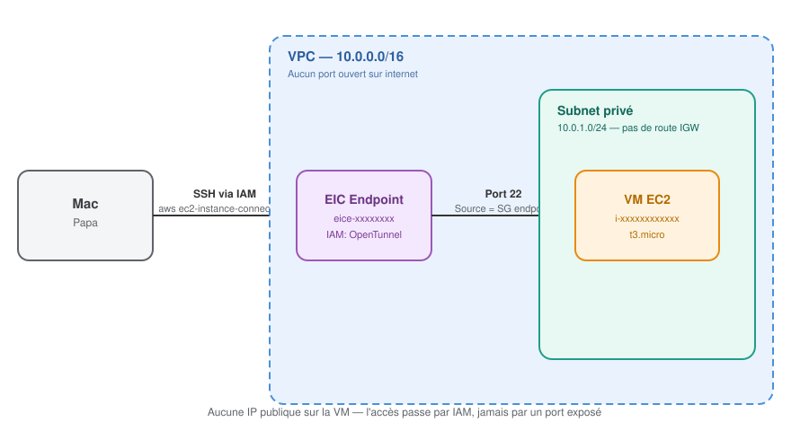
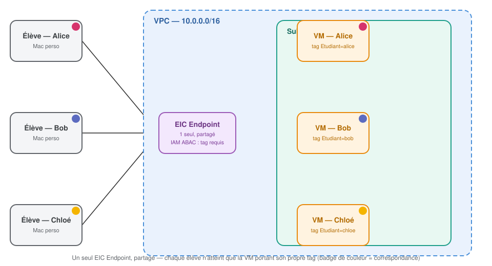

# Guide de mise en place — VPC privé, VM et EIC Endpoint

2026-09-17

## 1. Vue d'ensemble



Un seul point d'entrée managé par AWS (l'EIC Endpoint) permet au Mac d'atteindre une VM totalement privée, sans qu'aucun port ne soit jamais ouvert sur internet.

Le flux, résumé sur le schéma ci-dessus : le Mac s'authentifie via IAM auprès de l'endpoint, qui relaie la connexion SSH jusqu'à la VM. Celle-ci n'a ni IP publique, ni port entrant exposé au monde extérieur — seul le Security Group de l'endpoint est autorisé à lui parler.

## 2. Étapes 1 à 3 — VPC, subnet et VM

### Étape 1 — Créer le VPC

```bash
aws ec2 create-vpc --cidr-block 10.0.0.0/16 --tag-specifications 'ResourceType=vpc,Tags=[{Key=Name,Value=vpc-cours}]'
```

Noter le `VpcId` retourné : il est réutilisé dans toutes les commandes suivantes.

### Étape 2 — Créer le subnet privé

```bash
aws ec2 create-subnet --vpc-id vpc-xxxx --cidr-block 10.0.1.0/24 --tag-specifications 'ResourceType=subnet,Tags=[{Key=Name,Value=subnet-prive}]'
```

Aucune route vers un Internet Gateway — c'est ce qui en fait un vrai subnet privé.

### Étape 3 — Lancer la VM

Les images Ubuntu officielles sur AWS embarquent également le paquet `ec2-instance-connect`, rien à installer côté OS. Trouver l'AMI Ubuntu la plus récente (Canonical, owner `099720109477`) :

```bash
aws ec2 describe-images --owners 099720109477 --filters "Name=name,Values=ubuntu/images/hvm-ssd*/ubuntu-*-amd64-server-*" --query 'Images | sort_by(@, &CreationDate)[-1].ImageId' --output text
```

Puis lancer l'instance, sans IP publique :

```bash
aws ec2 run-instances \
  --image-id ami-xxxxxxxx \
  --instance-type t3.micro \
  --subnet-id subnet-xxxx \
  --no-associate-public-ip-address \
  --security-group-ids sg-vm-xxxx
```

## 3. Étape 4 — Créer l'EIC Endpoint

```bash
aws ec2 create-instance-connect-endpoint --subnet-id subnet-xxxx --security-group-ids sg-endpoint-xxxx
```

C'est ce point de terminaison, géré entièrement par AWS, qui fait office de tunnel entre le Mac et la VM. Sans lui, aucune connexion n'est possible vers une VM sans IP publique — c'est la pièce centrale du schéma en violet.

## 4. Étapes 5 et 6 — Security Group et droits IAM

### Étape 5 — Autoriser le Security Group de la VM

La source autorisée doit être le Security Group de l'endpoint, jamais une IP :

```bash
aws ec2 authorize-security-group-ingress --group-id sg-vm-xxxx --protocol tcp --port 22 --source-group sg-endpoint-xxxx
```

### Étape 6 — Droits IAM

Sur l'utilisateur ou le rôle qui se connectera :

- `ec2-instance-connect:OpenTunnel`
- `ec2-instance-connect:SendSSHPublicKey`
- `ec2:DescribeInstances`
- `ec2:DescribeInstanceConnectEndpoints`

## 5. Étape 7 — Tester la connexion

```bash
aws ec2-instance-connect ssh --instance-id i-xxxx --connection-type eice --os-user ubuntu
```

Sans NAT Gateway, la VM n'a pas d'accès internet sortant (pas de `yum update`) — sans impact pour valider l'accès, à ajouter plus tard si besoin.

## 6. Étendre à plusieurs élèves — vue d'ensemble



Un seul EIC Endpoint suffit pour toute la classe. Ce qui isole chaque élève n'est pas un endpoint séparé, mais un **tag IAM identique** entre l'élève et sa VM :

- Chaque VM porte un tag, par exemple `Etudiant=alice`
- Chaque élève (utilisateur IAM) porte le même tag sur son identité
- Une seule policy IAM, valable pour tous, autorise l'ouverture du tunnel uniquement quand les deux tags correspondent

Ni policy par élève à écrire, ni endpoint à dupliquer — seulement une VM et un utilisateur IAM en plus par élève, chacun avec son tag.

## 7. Créer une VM taguée par élève

Répéter l'étape 3 pour chaque élève, en changeant uniquement le tag :

```bash
aws ec2 run-instances \
  --image-id ami-xxxxxxxx \
  --instance-type t3.micro \
  --subnet-id subnet-xxxx \
  --no-associate-public-ip-address \
  --security-group-ids sg-vm-xxxx \
  --tag-specifications 'ResourceType=instance,Tags=[{Key=Name,Value=vm-alice},{Key=Etudiant,Value=alice}]'
```

Changer seulement `vm-alice` et `Etudiant,Value=alice` pour l'élève suivant (`vm-bob` / `bob`, etc.). Le même Security Group `sg-vm-xxxx` peut être réutilisé pour toutes les VM — seul le tag les distingue.

## 8. Policy IAM ABAC et isolation réseau

### Une policy pour tous les élèves

Créer un utilisateur IAM par élève, avec le même tag que sa VM :

```bash
aws iam tag-user --user-name alice --tags Key=Etudiant,Value=alice
```

Puis attacher cette seule policy à tous les utilisateurs élèves :

```json
{
  "Version": "2012-10-17",
  "Statement": [{
    "Effect": "Allow",
    "Action": ["ec2-instance-connect:OpenTunnel", "ec2-instance-connect:SendSSHPublicKey"],
    "Resource": "arn:aws:ec2:eu-west-1:111122223333:instance-connect-endpoint/eice-xxxxxxxx",
    "Condition": {
      "StringEquals": { "aws:ResourceTag/Etudiant": "${aws:PrincipalTag/Etudiant}" }
    }
  }]
}
```

L'action cible l'ARN de l'endpoint, pas celui d'une VM précise ; c'est la condition sur les tags qui restreint chaque élève à sa seule VM.

### Isoler les VM entre elles

Le Security Group des VM doit autoriser l'entrée uniquement depuis celui de l'endpoint — jamais depuis les autres VM. Sans cette règle, un élève pourrait techniquement rebondir vers la VM d'un camarade une fois connecté à la sienne.

## 9. Donner l'accès à chaque élève

Chaque élève configure, sur son propre Mac, un profil avec ses identifiants IAM :

```bash
aws configure --profile alice
```

Puis se connecte avec :

```bash
aws ec2-instance-connect ssh --instance-id i-xxxx --connection-type eice --os-user ubuntu --profile alice
```

Aucune clé SSH à distribuer : l'accès de chaque élève est entièrement défini par son utilisateur IAM et son tag — révoquer l'accès d'un élève revient simplement à désactiver son utilisateur IAM.
